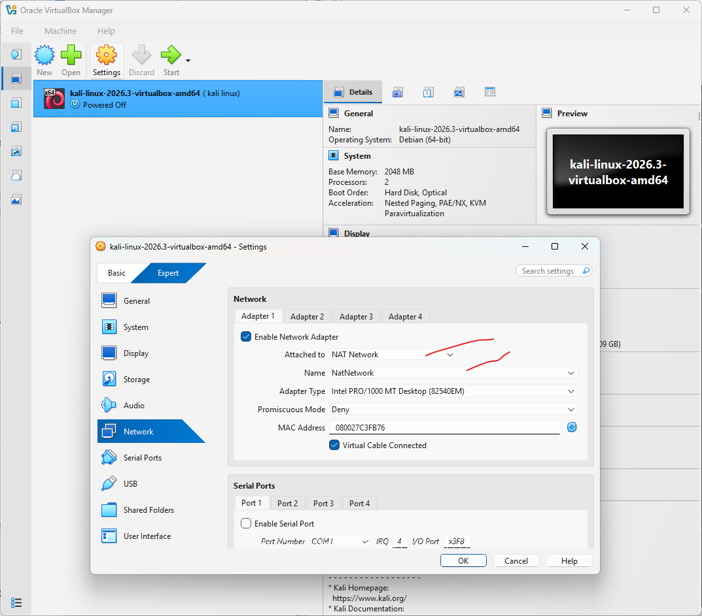
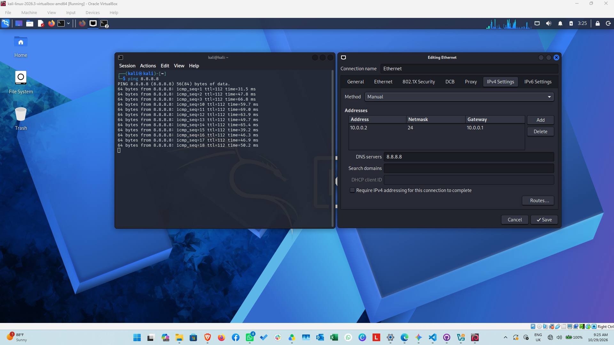
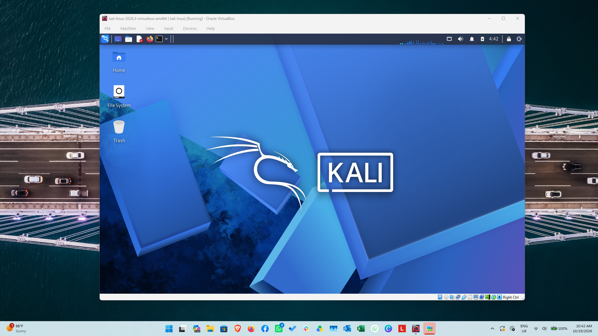

# CYBERSECURITY-LAB-SETUP

> A comprehensive reference architecture and deployment guide for provisioning an isolated, fully functional cybersecurity testing and monitoring environment.

---

##  Overview

**CYBERSECURITY-LAB-SETUP** provides everything needed to build a secure, isolated security range for analysis, hands-on learning, defensive monitoring, and offensive security testing.

Whether you are capturing network traffic, evaluating detection rules, analyzing malware, or running penetration testing drills, this repository outlines the infrastructure, network topology, and automated scripts required to get your lab running quickly and safely.


##  Prerequisites & Tech Stack

Before deploying, ensure your host environment meets the minimum hardware requirements:

### Hardware Requirements

* **CPU:** 4+ Cores (VT-x / AMD-V virtualization enabled in BIOS)
* **RAM:** 8 GB minimum (16 GB recommended)
* **Storage:** 100 GB+ SSD space free

### Software & Tools

- **7-Zip:** [https://7-zip.org/download.html](https://7-zip.org/download.html)
- **VirtualBox:** [https://virtualbox.org/wiki/Downloads](https://virtualbox.org/wiki/Downloads)
- **Kali Linux:** [https://kali.org/get-kali](https://kali.org/get-kali)

### step-1 Install Virtual Box 

install virtual box as the hypervisor 

## step-2 Create a NAT Network

A dedicated NAT Network was created in VirtualBox.

Configuration:
Network Name: NatNetwork
IPv4 Prefix:  10.0.0.0/24
DHCP:         Enabled
IPv6:         Disabled

[](nat.png)


## Step-3 Import Kali Linux

The Kali Linux virtual machine was downloaded from the official Kali Linux website and imported into VirtualBox.

The VM network adapter was configured as follows:

```text
Adapter 1
Attached to: NAT Network
Network:     NatNetwork
Adapter Type: Intel PRO/1000 MT Desktop(82540EM)
```

The VM was allocated:

```text
RAM: 2048 MB
```



### Step-4 Configure the Kali Linux Network

The Kali Linux network configuration was checked and configured with a consistent IPv4 address.

configuration:

```text
IP Address: 10.0.0.2
Subnet Mask: 255.255.255.0
Gateway: 10.0.0.1
DNS: 8.8.8.8
```






## 3. Deploy the Environment


### . Documentation

I learned that documenting commands, configuration, screenshots, problems, and solutions is an important part of a professional cybersecurity project.

---


## 🛡️ Safety & Disclaimer

> ⚠️ **IMPORTANT DISCLAIMER**
> This repository is strictly created for **educational, research, and defensive security testing purposes**. All activities conducted within this lab environment must remain isolated from external networks. Do not use any tools or scripts provided here on systems without explicit prior written authorization.

---

##  Author
ALBERT STEPHEN

Lindedln: https://www.linkedin.com/in/albert-stephen-2k26/

## Project Information

**Program Name:** Cybersecurity at Networkwalks | **Week:** 01 | **Project:** Cybersecurity & Pentesting Lab Setup | **Repository:** GitHub
**Repository:** GitHub

```

```

